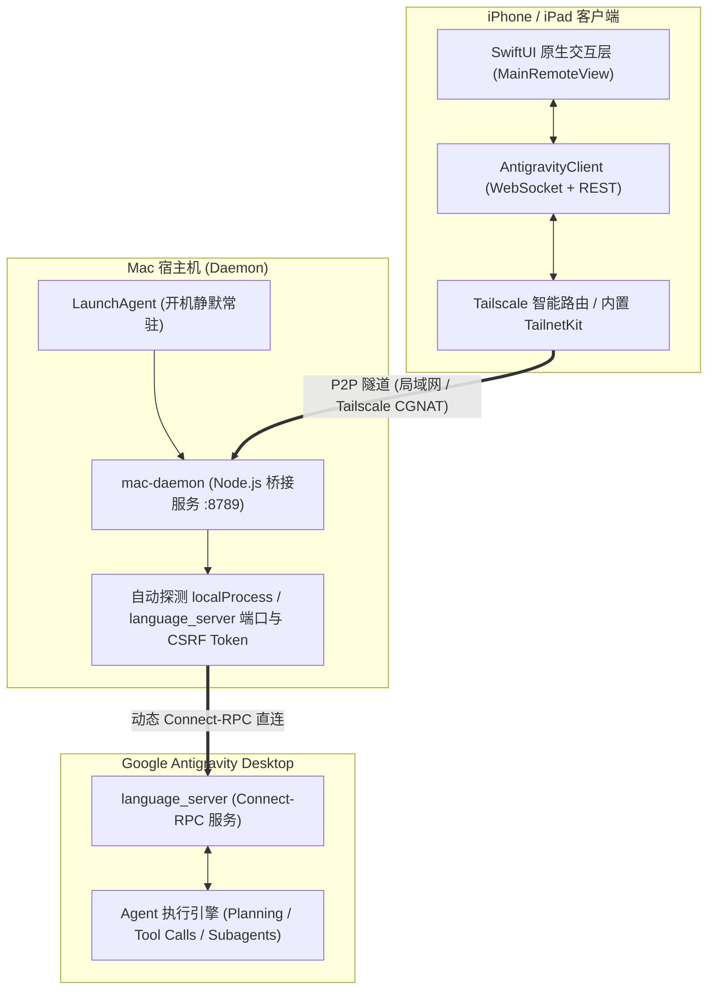

# Antigravity Remote (iOS 原生 App + 满血 PWA + 极简 Mac 桥接)

> 💡 **项目定位**：专为**无法使用官方 Antigravity Remote Control 的账号**（如土耳其区等受地区/账号策略限制无法开启官方网页远程控制的账号）设计的满血版第三方移动端远程控制系统。无论是在通勤路上、会议室还是躺在沙发上，都能通过 iPhone / iPad 实时监控、流式交互与决策审批 Mac 上的 Antigravity 编码进度。

---

> [!WARNING]
> ### ⚠️ App Store 状态说明
> **本应用目前暂未上架 App Store**。用户可通过以下两种方式在 iPhone / iPad 上自由使用：
>
> 1. **方式一（原生 iOS App，推荐）**：克隆本仓库代码，使用 Xcode 免费个人开发者证书（Personal Team）一键自签安装到自己的 iPhone 真机，畅享极致原生流畅度与系统级触感反馈；
> 2. **方式二（免编译 Safari PWA 全屏模式）**：在 Mac 终端运行一行安装脚本后，直接用 iPhone Safari 扫描配对页上的「Safari 网页版直连码」并点击底部分享 → **「添加到主屏幕」**，即可零编译、免 Xcode 获得独立全屏 Web App 体验。

---

## ⚡️ 极速安装：Mac 端一键配置 (10秒就绪)

在您的 Mac 终端中运行以下一键脚本即可完成所有后台配置与自启注册：

```bash
curl -fsSL https://raw.githubusercontent.com/lilingdeveloper/antigravity-remote/main/install.sh | bash
```

> **免安装 Node 环境**：脚本会自动复用电脑内 Antigravity 的内置 Node 运行时，无需额外安装任何环境或第三方依赖！
> **开机自启**：自动注册 macOS `LaunchAgent`（`~/Library/LaunchAgents/com.liling.antigravity-remote.plist`），开机静默常驻，重启不丢连接。
> **自动弹出**：服务就绪后将自动在 Mac 默认浏览器弹出扫码配对页（`http://127.0.0.1:8789/qr`）。

---

## 📱 手机端 2 步扫码配对

```text
 ┌──────────────┐          ┌───────────────────────┐          ┌──────────────┐
 │  Mac 终端执行 │  ──────> │  浏览器弹出配对二维码页   │  ──────> │  iPhone 扫码  │
 │  install.sh  │          │ http://127.0.0.1:8789 │          │   瞬间连接   │
 └──────────────┘          └───────────────────────┘          └──────────────┘
```

1. **第一步（生成二维码）**：
   Mac 终端运行安装命令后，浏览器会自动打开 `http://127.0.0.1:8789/qr`，展示包含当前局域网 IP 与 Tailscale 专属虚拟 IP 的配对二维码。
2. **第二步（手机扫码连接）**：
   - 打开 iPhone 上的 **Antigravity Remote** 原生 App（或打开 Safari PWA）。
   - 在顶部标题栏点击 **「扫码配对」**（或在设置中点击「扫码连接电脑」）。
   - 对准电脑屏幕上的二维码一扫，App 自动解析并建立实时双向 WebSocket 通信！

---

## 🏗 系统架构设计



### 1. 底层 Connect-RPC 协议直连
不同于脆弱的无头浏览器 DOM 劫持或固定端口代理，Antigravity Remote 能够自动发现本机 Antigravity `language_server` 的动态端口与安全 `--csrf_token`，并在 Antigravity 重启或重新加载窗口后秒级自动重连。

### 2. Tailscale 智能冲突检测与自动避让
- 实时探测系统 `utun*` 网络接口（`100.64.0.0/10` CGNAT 网段）。
- **当检测到系统已开启 Tailscale 时**：自动避让并关闭 App 内嵌的 `TailnetKit`，直接借力系统级路由加速，杜绝双节点隧道冲突并大幅降低移动端耗电。
- **当未开启系统 Tailscale 时**：无缝拉起内嵌 `TailnetKit.xcframework` 虚拟网卡，无论身处何地均可一键穿透连接家里的 Mac。

---

## ✨ 核心特性

- **思考流实时展现**：支持展开/折叠 Agent 的 `Thinking` 深度思考过程，实时跟踪规划脉络。
- **交互审批流移动化**：
  - 在手机上一键 `Approve` 授权终端 Shell 命令执行；
  - 批准 `/plan` 实施方案；
  - 交互式回答 Agent 的多选问题（`ask_question`）。
- **上下文进度条掌控**：实时查看当前会话消耗的 Token 比例与上限，并支持在设置中一键开启/隐藏。
- **会话无缝切换**：修复长对话与短对话切换时的滚动边界异常，确保丝滑无白屏。
- **全生命周期控制**：随时切换 Gemini / Claude 等模型，失控任务一键 `Stop` 紧急熔断。

---

## 🛠 iOS 源码构建指南

1. **环境准备**：
   - macOS 14.0+，Xcode 15.0+。
   - iPhone 真机（iOS 17.0+）或 iOS 模拟器。
2. **打开工程**：
   ```bash
   open "ios-app/AntigravityRemote.xcodeproj"
   ```
3. **针对 GitHub 100MB 限制的瘦身设计**：
   - 依赖的 `TailnetKit.xcframework` 已剔除超过 100MB 的非 iOS 架构（macOS 与 Mac Catalyst），完整保留了真机所需的 `ios-arm64`（50MB）与模拟器 `ios-arm64_x86_64-simulator`，克隆即可直接在 Xcode 中编译通过（`BUILD SUCCEEDED`）。
4. **编译运行**：
   在 Xcode 顶部选择您的 iPhone 设备，配置您的个人开发者免费签名（Personal Team），按 `⌘R` 即可部署安装。
